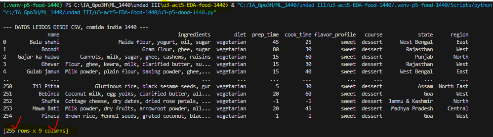
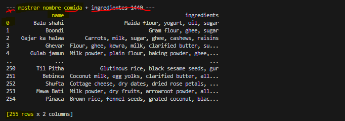
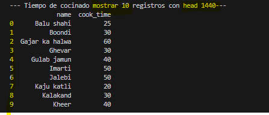
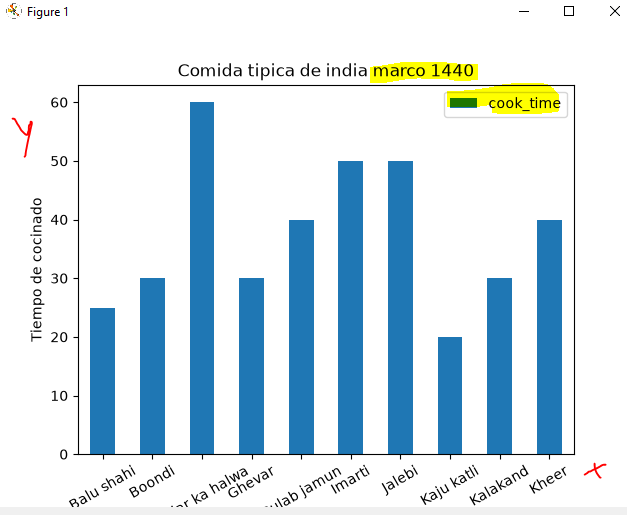
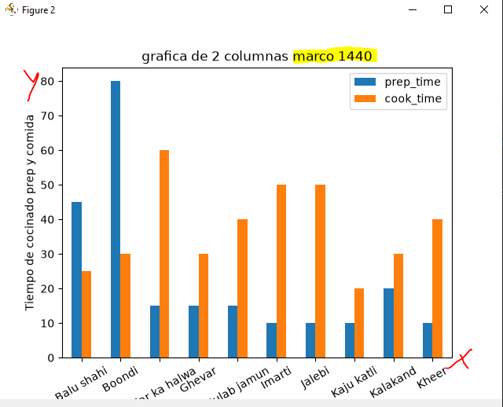
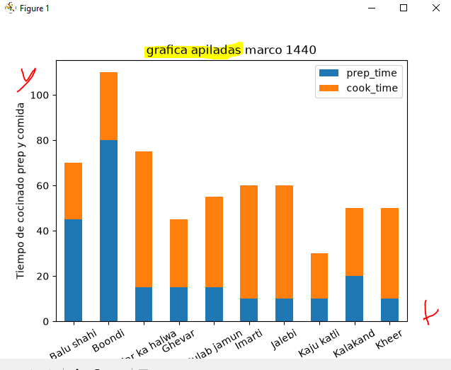

### analisis exploratorio de datos
## comida del pais india 
## marco morquechp NC 1440
### +-+-+ importando datos del archivo csv comida de india +-+-+

## +-+-+ mostrar nombre comida + ingredientes

### tiempo de cocinado mostrar 10 registros con head 1440

## creacion de graficas de barras 1440

## GRaficas de varias columnas

## Grafica apilada
